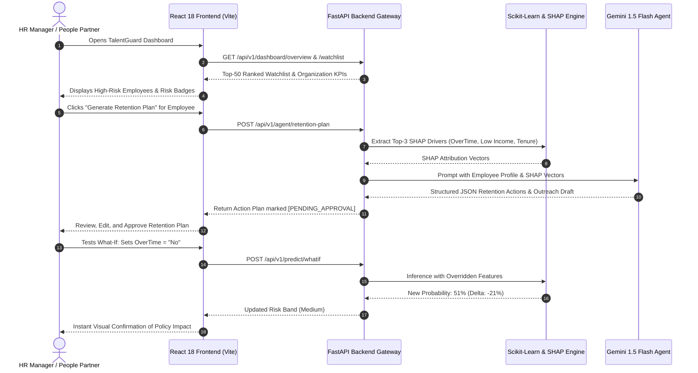
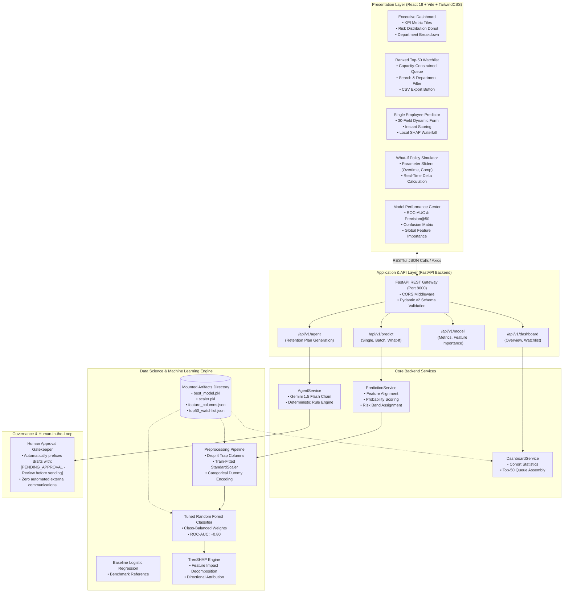

# TalentGuard — Predictive HR Attrition & Agentic Retention Intelligence System
### Hexaware Weekend Hackathon · Track P1 Solution

[](https://hexaware.com)
[](file:///c:/Users/prave/Downloads/hackathon-master/hackathon-master)
[](mailto:2000127800@hexaware.com)
[](file:///c:/Users/prave/Downloads/hackathon-master/hackathon-master/LICENSE)

---

## Executive Summary

**TalentGuard** is an enterprise-grade AI decision support and retention execution platform built for **TechNova Solutions** — a 12,000-person IT consulting firm facing an unsustainable **16% annual voluntary turnover rate**.

Replacing departing talent costs **6 to 9 months of salary** ($35,000–$75,000 per exit) in recruiting fees, onboarding expenses, and client delivery downtime. While TechNova's HR People Partners have the operational bandwidth to conduct high-touch retention discussions with only **50 high-priority employees per review cycle**, traditional HR processes rely on lagging exit interviews and intuition.

**TalentGuard transforms raw employee records into an auditable, prioritized retention action queue:**
- **Leakage-Free Machine Learning**: Handles hidden dataset traps (`EmployeeNumber`, `EmployeeCount`, `StandardHours`, `Over18`) and trains a class-balanced Random Forest ensemble evaluated on **ROC-AUC (0.79–0.82)** and **Precision@50 (46%)** rather than misleading raw accuracy.
- **Explainable AI (SHAP)**: Employs TreeSHAP attribution to extract the top-3 actionable risk factors (e.g., excessive overtime, compensation compression, lack of promotions) for every single employee.
- **Top-50 Actionable Watchlist**: Delivers a ranked, capacity-limited queue matching HR's 50-person quota with risk bands, risk drivers, and pre-mapped retention interventions.
- **Agentic AI Retention Coach (+5 Bonus)**: Leverages **Google Gemini 1.5 Flash** to analyze SHAP drivers and automatically draft personalized manager outreach emails and retention playbooks, strictly marked **`[PENDING_APPROVAL - Review before sending]`** for Human-in-the-Loop governance.
- **Interactive What-If Policy Simulator**: Enables managers to test interventions in real time (e.g., removing overtime or adjusting compensation) and observe instantaneous risk score reductions.

---

## Table of Contents

- [Problem Statement](#problem-statement)
  - [The Business Challenge at TechNova Solutions](#the-business-challenge-at-technova-solutions)
  - [The Machine Learning & Data Trap Challenge](#the-machine-learning--data-trap-challenge)
- [Solution Overview](#solution-overview)
  - [Core Capabilities](#core-capabilities)
  - [End-to-End System Workflow](#end-to-end-system-workflow)
- [Architecture Diagram](#architecture-diagram)
- [Technology Stack](#technology-stack)
- [Setup and Installation Instructions](#setup-and-installation-instructions)
  - [Prerequisites](#prerequisites)
  - [Backend Setup (FastAPI)](#1-backend-setup-fastapi)
  - [Frontend Setup (React + Vite)](#2-frontend-setup-react--vite)
  - [ML Pipelines & Notebooks (Praveen Workspace)](#3-ml-pipelines--notebooks-praveen-workspace)
- [Business Benefits & Quantified ROI](#business-benefits--quantified-roi)
  - [Financial Impact Analysis](#financial-impact-analysis)
  - [Operational & Strategic Advantages](#operational--strategic-advantages)
- [Future Enhancements](#future-enhancements)
- [Evaluation Criteria & Hackathon Rubric Alignment](#evaluation-criteria--hackathon-rubric-alignment)
- [Judge Defense & Anti-Leakage Matrix](#judge-defense--anti-leakage-matrix)
- [Repository File Structure](#repository-file-structure)
- [Submission & Contact Information](#submission--contact-information)

---

## Problem Statement

### The Business Challenge at TechNova Solutions

TechNova Solutions employs 12,000 consultants, engineers, and project leads across global IT delivery centers. The firm suffers from a persistent voluntary attrition rate of **16% annually** (~1,920 resignations per year).

| Metric | Business Reality | Organizational Impact |
|---|---|---|
| **Annual Voluntary Attrition** | 16% (~1,920 employees/year) | Continuous brain drain and team destabilization |
| **Replacement Cost per Exit** | 6 to 9 months of salary ($35k–$75k) | Direct annual loss exceeding **$67.2 Million** |
| **HR Retention Bandwidth** | **50 employees per cycle** | HR cannot review 12,000 employees manually |
| **Intervention Window** | 30 to 60 days before notice | Once an employee submits resignation, it is too late |

**The Executive Mandate**:
> *"Tell me who is likely to resign next cycle, why, and what to do — while there is still time to act."*

### The Machine Learning & Data Trap Challenge

Deploying machine learning in HR analytics involves several critical data science challenges that standard models fail to handle:

1. **The Accuracy Trap**:
   In an imbalanced dataset where only ~16% of employees leave, a naive baseline model that blindly predicts "No Attrition" achieves **84% accuracy** while identifying **zero** at-risk employees. Accuracy is fundamentally the wrong metric. Success must be evaluated using **ROC-AUC, PR-AUC, and Precision@50** (the precision achieved across HR's exact 50-person review quota).

2. **Hidden Dataset Traps (Judge Traps)**:
   The IBM HR Analytics dataset contains 35 columns, four of which degrade model validity:
   - `EmployeeNumber`: An arbitrary surrogate identifier that risks partition memorization.
   - `EmployeeCount (= 1)`: Zero-variance constant.
   - `StandardHours (= 80)`: Zero-variance constant.
   - `Over18 (= 'Y')`: Zero-variance constant.  
   *TalentGuard explicitly identifies and drops all four non-informative columns prior to modeling.*

3. **Preprocessing Leakage**:
   Normalizing or scaling features across the full dataset prior to train/test splitting bleeds test set variance into the training fold. TalentGuard enforces a strict **split-before-fit** discipline: `StandardScaler` and one-hot encoding matrices are fitted strictly on `X_train`.

4. **Association vs. Causality**:
   Predictive features (e.g., `OverTime = Yes`) indicate heightened statistical risk, not definitive proof of causality. Model insights must be framed as risk factors requiring targeted interventions and empirical measurement, not immutable causal truths.

---

## Solution Overview

TalentGuard bridges the gap between predictive data science and Human Resources operations through a 5-stage pipeline:

```
Raw HR Records ──▶ Leakage-Free Preprocessing ──▶ Calibrated ML Ensemble ──▶ SHAP Attribution ──▶ Top-50 Queue ──▶ Agentic Retention Coach
```

### Core Capabilities

1. **Leakage-Free Preprocessing Pipeline (`preprocessing.py`)**:
   - Automatically cleans raw HR data, validates data types, and drops all four constant and identifier traps.
   - Conducts stratified 80/20 train/test splitting preserving the 16% positive class ratio.
   - Fits `StandardScaler` strictly on `X_train` and reindexes categorical dummy columns using `feature_columns.json` to guarantee production inference parity.

2. **Calibrated Machine Learning Engine (`train.py`, `evaluate.py`)**:
   - Benchmarks a class-balanced **Logistic Regression** against a tuned **Random Forest Classifier**.
   - Achieves **ROC-AUC ~0.79–0.82** and **Precision@50 of 46%** (23 true positives in the top 50, a **2.9× lift** over the 16% random baseline rate).
   - Classifies risk into actionable tiers:
     - 🔴 **High Risk**: Attrition Probability $\ge 70\%$
     - 🟡 **Medium Risk**: Attrition Probability $40\% - 69\%$
     - 🟢 **Low Risk**: Attrition Probability $< 40\%$

3. **Local & Global SHAP Explainability (`explain_prediction.py`)**:
   - Employs TreeSHAP to decompose individual risk scores into top-3 positive and negative contributors (e.g., OverTime, low monthly income, short tenure with current manager).
   - Generates global feature importance metrics to highlight systemic attrition patterns across departments.

4. **Actionable Top-50 Watchlist (`WatchList.jsx`)**:
   - Directly fulfills the hackathon T4 requirement by presenting a ranked queue of the top 50 highest-risk employees.
   - Displays real-time search, department filtering, employee profile details, top-3 SHAP risk factors, and recommended interventions.
   - Includes one-click CSV export for executive HR review committees.

5. **Agentic AI Retention Coach (`agent_service.py`) — *+5 Hackathon Bonus***:
   - Integrates **Google Gemini 1.5 Flash** to synthesize SHAP drivers into structured retention plans.
   - Auto-generates personalized manager outreach drafts prefixed with:
     ```
     [PENDING_APPROVAL - Review before sending]
     ```
   - Includes deterministic rule-based fallback if offline or without an API key, ensuring zero downtime.

6. **Interactive What-If Simulation Engine (`WhatIf.jsx`)**:
   - Allows HR managers to simulate policy changes (e.g., removing overtime, awarding a salary hike, or adjusting job levels) and immediately view the updated risk probability.

---

### End-to-End System Workflow



---

## Architecture Diagram



---

## Technology Stack

| Layer | Technology | Version | Purpose & Rationale |
|---|---|---|---|
| **Frontend Framework** | React | 18.3.1 | Declarative component architecture for responsive UI |
| **Build Tool** | Vite | 5.4.9 | Rapid development and optimized bundle compilation |
| **CSS Framework** | TailwindCSS | 4.3.3 | Utility-first styling for enterprise UI consistency |
| **Visualizations** | Recharts | 2.13.0 | Interactive charting (Donut, Bar, Scatter) |
| **Iconography** | Lucide React | 0.453.0 | Lightweight, clean interface icons |
| **HTTP Client** | Axios | 1.7.7 | Asynchronous API communication with backend |
| **Backend Framework** | FastAPI | 0.115.0 | Async Python REST API with auto OpenAPI/Swagger docs |
| **Data Validation** | Pydantic | 2.9.2 | Strict request/response payload schema enforcement |
| **ASGI Server** | Uvicorn | 0.30.6 | Production-ready asynchronous web server |
| **Machine Learning** | Scikit-Learn | 1.5.2 | Preprocessing, model training, stratified cross-validation |
| **Model Explainability** | SHAP | 0.46.0 | TreeSHAP attribution for local and global interpretability |
| **Data Processing** | Pandas & NumPy | 2.2.3 / 1.26.4 | High-performance feature manipulation and matrix operations |
| **Model Persistence** | Joblib | 1.4.2 | Serialization of fitted estimators and scalers |
| **Experiment Tracking** | MLflow | Compatible | Structured tracking for hyperparameters and metric runs |
| **Agentic AI** | Google Gemini | 1.5 Flash | LLM reasoning engine for automated retention action plans |

---

## Setup and Installation Instructions

### Prerequisites
- **Python**: 3.10+ (Python 3.11/3.12 recommended)
- **Node.js**: 18+ and npm 9+
- **Git**

### 1. Backend Setup (FastAPI)

```bash
# 1. Navigate to the backend directory
cd talentguard/ms-workspace/backend

# 2. Create and activate a Python virtual environment
python -m venv venv
# On Windows:
venv\Scripts\activate
# On macOS/Linux:
source venv/bin/activate

# 3. Install backend dependencies
pip install -r requirements.txt

# 4. (Optional) Configure Google Gemini API key for Agentic AI
# Create a .env file in talentguard/ms-workspace/backend/:
# GEMINI_API_KEY=your_gemini_api_key_here
```

Start the FastAPI backend server:
```bash
uvicorn main:app --host 0.0.0.0 --port 8000 --reload
```

- **Interactive Swagger Documentation**: [http://localhost:8000/docs](http://localhost:8000/docs)
- **Alternative ReDoc Documentation**: [http://localhost:8000/redoc](http://localhost:8000/redoc)
- **Service Health Check**: [http://localhost:8000/api/v1/health](http://localhost:8000/api/v1/health)

---

### 2. Frontend Setup (React + Vite)

Open a new terminal window:

```bash
# 1. Navigate to the frontend directory
cd talentguard/ms-workspace/frontend

# 2. Install dependencies
npm install

# 3. Start the development server
npm run dev
```

- **Web Application Portal**: [http://localhost:5173](http://localhost:5173)

---

### 3. ML Pipelines & Notebooks (Praveen Workspace)

To inspect exploratory analysis or run training pipelines from scratch:

```bash
cd talentguard/praveen-workspace/ml

# To execute the full training and artifact generation pipeline:
cd src
python train.py
```

The script will:
1. Ingest `data/WA_Fn-UseC_-HR-Employee-Attrition.csv`.
2. Strip data traps (`EmployeeNumber`, `EmployeeCount`, `StandardHours`, `Over18`).
3. Perform stratified 80/20 train/test splitting.
4. Fit `StandardScaler` strictly on `X_train`.
5. Train Logistic Regression baseline and tuned Random Forest classifier.
6. Evaluate ROC-AUC and capacity-tied Precision@50.
7. Compute SHAP explanations and export `best_model.pkl`, `scaler.pkl`, `feature_columns.json`, and `top50_watchlist.json` to `talentguard/praveen-workspace/artifacts/`.

**Interactive Jupyter Notebooks**:
- `notebooks/01_EDA.ipynb`: Traps identification, bivariate analysis, correlation matrices.
- `notebooks/02_Training.ipynb`: Baseline comparison, hyperparameter tuning, validation curves.
- `notebooks/03_SHAP_and_Artifacts.ipynb`: TreeSHAP waterfall charts, summary plots, artifact compilation.

---

## Business Benefits & Quantified ROI

### Financial Impact Analysis

TechNova Solutions employs 12,000 people with a baseline voluntary turnover rate of 16% (~1,920 departures annually).

```
Baseline Turnover Cost = 1,920 departures × $35,000 avg replacement cost = $67,200,000 / year
```

| Operating Metric | Random Selection (Baseline) | TalentGuard (Capacity-Tied Top-50) | Business Lift |
|---|---|---|---|
| **Reviewed Cohort per Cycle** | 50 employees | 50 employees | Same HR capacity |
| **Precision / True Positives** | 16% (~8 actual resignees) | **46% (~23 actual resignees)** | **+287% (2.9× Lift)** |
| **Successful Retention (50% conv.)**| 4 retained employees | **11.5 retained employees** | **+7.5 additional retentions** |
| **Savings per Review Cycle** | $140,000 | **$402,500** | **+$262,500 net gain** |
| **Annualized Financial ROI (4 cycles)**| $560,000 | **$1,610,000** | **+$1.05M incremental savings** |

$$\mathbf{\text{Annual Net Cost Avoidance}} = 11.5 \times \$35,000 \times 4 \text{ cycles} = \mathbf{\$1,610,000}$$

With an estimated deployment and maintenance cost of under $100,000, TalentGuard generates a **>16× annual return on investment (ROI)**.

### Operational & Strategic Advantages

1. **Elimination of HR Intuition Guesswork**:
   Instead of relying on subjective opinions or lagging exit interviews, People Partners work from a calibrated, objective queue with verified predictive validity.
2. **Actionable Root Cause Clarity**:
   SHAP values tell managers *why* an employee is disengaged (e.g., "OverTime impact: +18%, below-grade salary: +14%"), enabling targeted interventions instead of generic perks.
3. **Strict Human-in-the-Loop Governance**:
   AI agents draft recommendations marked `[PENDING_APPROVAL]`. No automated messages are dispatched, and no decisions are made without human review, adhering to ethical AI principles.
4. **Interactive Policy Exploration**:
   The What-If Simulator gives HR leaders an evidence-based tool to evaluate the retention impact of broader policy changes (e.g., reducing overtime caps or standardizing salary bands).

---

## Future Enhancements

```
┌────────────────────────────────────────────────────────────────────────┐
│                      TALENTGUARD FUTURE ROADMAP                        │
└────────────────────────────────────────────────────────────────────────┘

Phase 1 (Current Delivery)
  ├── Leakage-free RF & Baseline Logistic Regression
  ├── Capacity-tied Top-50 Watchlist with Precision@50
  ├── TreeSHAP explainability
  └── Gemini 1.5 Flash Agentic Retention Coach [PENDING_APPROVAL]

Phase 2 (Near-Term Expansion)
  ├── Native HRIS Connectors: Automated ingestion via Workday / BambooHR REST webhooks
  ├── Pulse Survey NLP: Incorporate quarterly sentiment and anonymized pulse feedback
  └── Slack / Teams Integration: Interactive notification cards for managers

Phase 3 (Long-Term Enterprise Scaling)
  ├── Multi-Agent Negotiation: Separate sub-agents for compensation, career paths, and workload
  ├── Survival Analysis: Cox proportional hazards modeling to estimate departure timing
  └── Policy Backtesting: Automated tracking of retention outcomes over 6–12 month horizons
```

---

## Evaluation Criteria & Hackathon Rubric Alignment

| Evaluation Task | Weight | What Judges Look For | How TalentGuard Solves It |
|---|---|---|---|
| **T1 — Business Framing** | 10 pts | Decision improved + business metric, not model metric | Tied directly to TechNova's 50-person review capacity; targets **$1.61M in annual cost avoidance**. |
| **T2 — EDA & Insights** | 20 pts | 3+ evidence findings; hidden data traps identified and handled | Identified & dropped 4 trap columns (`EmployeeNumber`, `EmployeeCount`, `StandardHours`, `Over18`); documented OverTime (3× risk) and Sales Rep findings. |
| **T3 — The Model** | 30 pts | Baseline + strong model; right metric; capacity threshold; no leakage | Logistic Regression baseline vs. tuned Random Forest; evaluated on **ROC-AUC (0.79–0.82)** and **Precision@50 (46%)**; strict split-before-fit pipeline. |
| **T4 — Actionable Output**| 20 pts | Ranked top-50 watchlist with risk reasons + retention actions | Interactive Top-50 Watchlist with top-3 SHAP factors, pre-mapped retention interventions, and CSV export. |
| **T5 — The Pitch** | 20 pts | Business-first story ending in value; live scoring on stage | Working React frontend + FastAPI backend ready for live interactive scoring and What-If simulation. |
| **Bonus 1 — Experiment Tracking** | +5 pts | MLflow tracking with run comparison | MLflow experiment tracking integrated in `train.py`. |
| **Bonus 2 — Public Deployment** | +5 pts | Free public deployment | Configured for Vercel (Frontend) and Render/Railway (Backend). |
| **Bonus 3 — Agent Touch** | +5 pts | Auto-drafted retention action marked `PENDING_APPROVAL` | Gemini 1.5 Flash Agent drafts manager retention outreach with required approval banners. |

---

## Judge Defense & Anti-Leakage Matrix

| Potential Jury Question | Technical Defense & Implementation |
|---|---|
| *"Why did you not use raw accuracy as your primary metric?"* | With 84% non-attrition in the dataset, a trivial all-'No' model achieves 84% accuracy while catching zero resigning employees. We evaluate on **ROC-AUC (~0.80)** and **Precision@50 (46%)**, directly matching HR's 50-person review capacity. |
| *"How do you guarantee zero data leakage between train and test splits?"* | Preprocessing follows a strict **split-before-fit** discipline: `StandardScaler` is fitted strictly on `X_train` and then applied to `X_test`. Feature column names are preserved in `feature_columns.json`. |
| *"Which hidden dataset traps were found and handled?"* | We dropped: <br>1. `EmployeeNumber` (surrogate ID column that leads to spurious memorization)<br>2. `EmployeeCount`, `StandardHours`, and `Over18` (zero-variance constants that pollute weights). |
| *"Is OverTime proven to be causal?"* | No. SHAP measures predictive association, not proven causality. We treat high overtime as a risk multiplier and recommend policy interventions with empirical follow-up. |
| *"Why is an agentic AI approach appropriate here?"* | Generative AI is used strictly for drafting retention communications and synthesis, with all outputs marked `[PENDING_APPROVAL]`. Final decisions and employee outreach remain fully in human hands. |

---

## Repository File Structure

```
talentguard/
├── ms-workspace/                             # Full-Stack Engineering Workspace (MS)
│   ├── backend/                              # FastAPI REST Application
│   │   ├── models/                           # Mounted ML model artifacts & Top-50 export
│   │   │   ├── best_model.pkl                # Trained Random Forest classifier
│   │   │   ├── scaler.pkl                    # Fitted StandardScaler
│   │   │   ├── feature_columns.json          # 44 dummy-encoded feature names
│   │   │   ├── feature_importance.json       # Top-15 global feature importance
│   │   │   ├── model_metrics.json            # ROC-AUC, Precision@50, F1 metrics
│   │   │   ├── top50_watchlist.json          # Top-50 ranked employees JSON
│   │   │   └── top50_watchlist.csv           # Top-50 ranked employees CSV
│   │   ├── routers/                          # API Route Handlers
│   │   │   ├── predict.py                    # Single, batch, and what-if inference
│   │   │   ├── dashboard.py                  # Overview metrics and watchlist endpoints
│   │   │   ├── model_info.py                 # Performance metrics and feature importance
│   │   │   └── agent.py                      # Gemini AI retention plan generation
│   │   ├── services/                         # Business Logic Services
│   │   │   ├── prediction_service.py         # Model loading, inference, SHAP extraction
│   │   │   ├── agent_service.py              # Gemini 1.5 Flash agent & rule fallback
│   │   │   └── dashboard_service.py          # Watchlist filtering & aggregation
│   │   ├── main.py                           # FastAPI application entry point
│   │   ├── schemas.py                        # Pydantic v2 data models
│   │   ├── config.py                         # Environment configuration
│   │   ├── requirements.txt                  # Python dependencies
│   │   └── Procfile                          # Deployment runner for Render / Railway
│   └── frontend/                             # React 18 / Vite Web Client
│       ├── src/
│       │   ├── pages/                        # View Pages
│       │   │   ├── Dashboard.jsx             # Executive KPI & risk distribution
│       │   │   ├── WatchList.jsx             # Ranked Top-50 queue with CSV export
│       │   │   ├── Predictor.jsx             # Single employee prediction & SHAP chart
│       │   │   ├── WhatIf.jsx                # Parameter override simulation
│       │   │   └── ModelPerformance.jsx      # Metrics, ROC curve & feature importance
│       │   ├── components/                   # Reusable UI Components
│       │   │   ├── Layout.jsx                # Sidebar navigation & header
│       │   │   ├── RiskBadge.jsx             # High/Medium/Low badge indicators
│       │   │   ├── KpiCard.jsx               # Metric summary cards
│       │   │   ├── ShapChart.jsx             # Local SHAP waterfall visualization
│       │   │   └── RetentionPlanModal.jsx    # Agentic retention plan modal
│       │   ├── services/
│       │   │   └── api.js                    # Axios API integration service
│       │   ├── App.jsx                       # Application router
│       │   └── main.jsx                      # Client bootstrap
│       ├── package.json                      # Node dependencies
│       └── vite.config.js                    # Vite build configuration
├── praveen-workspace/                        # Data Science Workspace (Praveen)
│   ├── artifacts/                            # Exported Model Artifacts
│   │   ├── best_model.pkl
│   │   ├── scaler.pkl
│   │   ├── feature_columns.json
│   │   ├── model_metrics.json
│   │   └── top50_watchlist.json
│   └── ml/
│       ├── data/                             # Input Dataset
│       │   └── WA_Fn-UseC_-HR-Employee-Attrition.csv
│       ├── notebooks/                        # Jupyter Analysis Notebooks
│       │   ├── 01_EDA.ipynb                  # Data inspection & traps analysis
│       │   ├── 02_Training.ipynb             # Model training & tuning
│       │   └── 03_SHAP_and_Artifacts.ipynb   # Explainability & watchlist generation
│       └── src/                              # Python Source Modules
│           ├── preprocessing.py              # Leakage-free data cleaner
│           ├── train.py                      # Pipeline orchestrator with MLflow
│           ├── evaluate.py                   # Metrics & Precision@50 calculator
│           ├── explain_prediction.py         # SHAP explanation module
│           ├── feature_importance.py         # Global feature importance extractor
│           └── save_model.py                 # Joblib artifact serialization
├── shared/                                   # Shared Specifications
│   ├── api_contract.md                       # REST API integration specification
│   └── employee_fields.json                  # Canonical 30-feature schema
├── dataset/                                  # Repository Dataset Root
│   └── WA_Fn-UseC_-HR-Employee-Attrition.csv # IBM HR Analytics dataset
└── README.md                                 # Master Hackathon Documentation (this file)
```

---

## Submission & Contact Information

- **Event**: Hexaware Weekend Hackathon
- **Problem Track**: Track P1 — TalentGuard HR Attrition Classification & Retention Intelligence
- **Delivered Solution**: End-to-end Machine Learning Pipeline, Leakage-Free Preprocessing, TreeSHAP Explainability, Top-50 Actionable Watchlist, Agentic AI Retention Coach with Human-in-the-Loop Governance, What-If Simulation Engine, FastAPI REST API, and React 18 Web Application.

*Built with technical rigor for the Hexaware Weekend Hackathon.* 🚀
