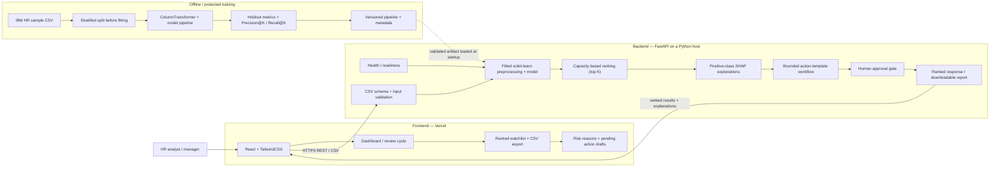

# TalentGuard — P1 Project Blueprint

**Purpose:** implementation-ready product and delivery plan for the TalentGuard employee-attrition use case  
**Hackathon constraint:** four-hour build, followed by a three-minute pitch  
**Requested stack:** React + Tailwind CSS, FastAPI, scikit-learn, Vercel plus a free/low-cost API host

## 1. Scope and challenge alignment

TalentGuard turns employee attrition scores into a **reviewable HR action queue**. It ranks a roster by predicted attrition risk, gives HR understandable risk drivers, and drafts retention actions for a human to review. The model supports—not replaces—HR judgment. It must not automatically make employment decisions or contact employees.

The default product output is a capacity-limited watchlist (50 employees per review cycle), with up to three explanation factors per employee and retention-action drafts for the highest-priority cases. Treat 50 as a configurable product setting and confirm the exact requirement against the P1 brief before the demo.

### Challenge-document discrepancy — resolve before submission

- `Challenge Instructions.docx` says teams should select **any two use cases**.
- The cover of `Hackathon_5_Projects_Pack.pdf` says teams get **one project**, assigned or drawn, and lists P1 TalentGuard among five projects.

This blueprint is deliberately scoped to **P1 TalentGuard**, as requested. It describes two connected TalentGuard workflows—(1) attrition-risk prioritization and (2) retention planning—but these are not represented as two separate challenge projects. Confirm with the organizer which instruction governs the submission. If two separate projects are required, this P1-only deliverable will need a second project plan.

The project-pack cover describes a four-hour build, a three-minute pitch, and a Python/scikit-learn/MLflow/Streamlit stack with no Azure. This blueprint follows the requested React/FastAPI/Vercel stack instead; MLflow remains an optional experiment-tracking enhancement.

## 2. Supplied files and what they are for

| Supplied item | What it contains / how TalentGuard uses it |
|---|---|
| `Challenge Instructions.docx` | Submission requirements: source code, supporting artifacts, a solution document, README, architecture, setup, business benefits, and evaluation criteria. Contains the two-use-case requirement noted above. |
| `Hackathon_5_Projects_Pack.pdf` | Hackathon format and five project names. Its cover identifies P1 as TalentGuard attrition classification and describes the time and stack constraints. |
| `dataset/WA_Fn-UseC_-HR-Employee-Attrition.csv` | IBM HR Analytics sample dataset. It has 1,470 records and 35 columns including the target `Attrition`; use it for a reproducible demo, not as evidence that a model is production-ready for a real employer. |
| `employee-attrition-prediction-main/README.md` | Explains the supplied attrition-classification example, its models, artifact files, and SHAP-based explanation. |
| `employee-attrition-prediction-main/notebooks/EDA.ipynb` | Existing exploratory analysis. Re-check every finding against the dataset and include only findings the team can reproduce and explain. |
| `employee-attrition-prediction-main/main.py` | Orchestrates preprocessing, tuning, evaluation, feature-importance output, artifact saving, and a sample SHAP explanation. Useful as a training-flow reference, but too broad to run as part of an API request. |
| `employee-attrition-prediction-main/src/preprocessing.py` | Existing drop/encode/split/scale logic. Reuse the intent, but use a fitted preprocessing pipeline to prevent train/test preprocessing leakage and inference-time category drift. |
| `employee-attrition-prediction-main/src/train.py` | Baseline definitions for Logistic Regression, Decision Tree, Random Forest, KNN, and SVM. For a four-hour MVP, compare a Logistic Regression baseline with a Random Forest rather than tuning all five. |
| `employee-attrition-prediction-main/src/tune_models.py` | Grid/randomized search examples. Useful after the baseline works; exhaustive searches are not a four-hour MVP dependency. |
| `employee-attrition-prediction-main/src/evaluate.py` | Example classification metrics. Add capacity-aware ranking metrics; do not use accuracy as the principal success measure for an imbalanced target. |
| `employee-attrition-prediction-main/src/feature_importance.py` | Random Forest global feature-importance chart. Adapt the data extraction to return JSON for the React UI; do not call `plt.show()` from an API request. |
| `employee-attrition-prediction-main/src/explain_prediction.py` | SHAP explanation and limited rule-based recommendations. Reuse the explanation concept, test the class/feature alignment, and make recommendations explicit drafts rather than causal claims. |
| `employee-attrition-prediction-main/src/predict.py` | Single/batch prediction example and joblib model loading. It aligns dummy columns with `reindex`; replace this fragile inference preprocessing with the same fitted transformer used in training. |
| `employee-attrition-prediction-main/src/save_model.py` | Writes the fitted estimator and scaler to `models/` with joblib. In TalentGuard, persist the complete fitted preprocessing/model pipeline plus versioned metadata instead of unrelated artifacts. |
| `employee-attrition-prediction-main/models/best_model.pkl` | Supplied fitted model candidate. Validate its provenance, scikit-learn version, feature order, performance, and behavior before serving it. A pickle/joblib artifact must only be loaded from a trusted source. |
| `employee-attrition-prediction-main/models/scaler.pkl` | Supplied fitted scaler. The supplied Random Forest is trained on unscaled features, and the current inference code does not apply this scaler. Do not add scaling at prediction time unless the selected model was trained with that same pipeline. |
| `employee-attrition-prediction-main/app/app.py` | Streamlit demo showing example employee fields. Use it to understand the sample input shape; it is not the requested React UI and hard-codes values for some features. |
| `employee-attrition-prediction-main/requirements.txt` | Existing Python dependencies, including pandas, scikit-learn, joblib, SHAP, and Streamlit. Pin compatible production versions in TalentGuard’s own backend requirements. |

### UI reference applications

| Reference | Current workspace finding | Practical use |
|---|---|---|
| `Cognigen/` | The named frontend/backend/AI subdirectories are present, but no files were found beneath them in this workspace. | No source UI component can currently be copied. Revisit if the source files are supplied. |
| `FastX/` | The named frontend/backend subdirectories are present, but no files were found beneath them in this workspace. | No source UI component can currently be copied. Revisit if the source files are supplied. |
| `Flowforge/` | The named UI/backend/AI subdirectories are present, but no files were found beneath them in this workspace. | No source UI component can currently be copied. Revisit if the source files are supplied. |
| `Hexa-MedPlus-main/frontend/` | Contains a React/Vite frontend, Tailwind configuration, reusable UI components, dashboard, and upload patterns. | Best available reference: adapt the Card, Button, status badge, dashboard layout, and upload-zone patterns. Keep TalentGuard’s own labels, risk semantics, and styles; check the source project’s license before copying code. |

Useful Hexa-MedPlus paths include `frontend/src/components/ui/Card/Card.jsx`, `frontend/src/components/ui/Button/Button.jsx`, `frontend/src/components/ui/Badge/StatusBadge.jsx`, `frontend/src/features/dashboard/pages/DashboardPage.jsx`, and `frontend/src/features/documents/components/DocumentUploadZone.jsx`.

The current workspace contains reference material and the attrition example, not a complete TalentGuard React/FastAPI application. Build the product in new `frontend/` and `backend/` directories (or another clearly documented layout); do not mistake the reference repositories for an existing TalentGuard implementation.

## 3. Dataset and modeling decisions

### Dataset handling

- Target: `Attrition` (`Yes` is the positive class; `No` is the negative class).
- The CSV has 35 columns including the target. Drop `EmployeeNumber` from model features because it is an identifier. Verify and drop constant/non-informative columns such as `EmployeeCount`, `Over18`, and `StandardHours`.
- Keep a non-sensitive, opaque row key separately if the UI needs to map a watchlist row to a demo record. Never train on that key.
- Validate required columns, allowed categories, data types, missing values, duplicate rows, and target values at ingestion. Reject invalid uploads with actionable errors.
- Preserve the data split before fitting encoders, imputers, scalers, or feature selection. Fit preprocessing on training folds only.
- Use a scikit-learn `Pipeline`/`ColumnTransformer` with a fitted `OneHotEncoder(handle_unknown="ignore")`, and use that same serialized pipeline at inference. Do not independently call `get_dummies` on each prediction request.

### Model selection and evaluation

1. Establish a stratified holdout set before model selection.
2. Train a simple Logistic Regression baseline and a Random Forest candidate using the training data. Use cross-validation or a validation split for tuning/model choice; reserve the holdout for the final report.
3. Select the model based on the intended HR capacity and validation performance, not on accuracy alone.
4. Report ROC-AUC and PR-AUC alongside precision, recall, and F1. For the ranked queue, report **Precision@K** (share of the reviewed top K who were positive in held-out data) and **Recall@K** (share of held-out positives present in that top K), with K matching the review capacity.
5. Treat model probabilities as ranking scores unless calibration has been evaluated. Risk bands are for display only and are not a substitute for the capacity-based queue.
6. Save the full fitted preprocessing-plus-model pipeline, feature schema, selected model/version, evaluation metrics, training-data checksum, and threshold/capacity settings. Use MLflow for experiment tracking if time permits; it is not needed to make the first vertical slice work.

The supplied repo’s Random Forest is a useful candidate, not a guaranteed production winner. Its evaluation and preprocessing need to be reproduced before using the saved model. The existing preprocessing creates dummy columns before the split, and `predict.py` can silently represent an unseen or missing category as all-zero dummy fields; the new pipeline should address both issues.

## 4. TalentGuard features

### Four-hour MVP — build these first

1. **Roster upload and validation:** upload the supplied CSV, show row/column validation, and explain missing or invalid fields.
2. **Ranked attrition watchlist:** score the eligible roster and present the top K (default 50) with rank, risk score, department/job role, and opaque employee reference.
3. **Individual explanation:** show the top three positive/negative SHAP contributors for selected watchlist records, with a plain-language label and a note that association is not causation.
4. **Retention action drafts:** for at most the top ten cases, map risk drivers to relevant options (for example workload review, career conversation, or compensation review). Each draft is marked `PENDING_APPROVAL`; a manager must edit/approve it. No automatic email or employment action.
5. **Dashboard summary:** cohort size, watchlist count, risk distribution, department summary, and top model-evaluation metrics.
6. **Export:** download a ranked CSV and an action-plan summary for the HR review meeting.

### Agentic workflow capability

Implement an auditable, bounded workflow rather than an unconstrained autonomous agent:

`validate cohort → score → rank to capacity → explain → propose actions → check output schema/policy → await HR approval → export/record decision`

For the hackathon MVP, use deterministic policy/rule mappings from explanation factors to action templates. An optional LLM may rewrite an approved template into a clearer draft, but it must receive only the minimum non-identifying factors, return a validated structured result, and never send messages or make decisions. Show when the LLM was used; if unavailable, report that clearly and offer the deterministic template path. Do not silently present fallback output as LLM-generated.

### Later enhancements — not four-hour commitments

- Authentication, role-based access, audit log, and employer-approved retention controls.
- Durable encrypted storage for cohorts, decisions, and prediction history.
- What-if comparisons, drift monitoring, fairness review, calibration, and controlled retraining.
- Optional LLM narrative generation with evaluation, privacy review, rate limits, and an explicit human approval gate.
- Notifications only after a manager approves an action and an organization configures a compliant delivery channel.

## 5. Training workflow

This is an offline or protected admin workflow, not a public endpoint exposed to every browser user.

1. **Ingest** the source CSV or an approved, de-identified HR extract.
2. **Validate** the schema, target labels, row counts, missingness, duplicates, categories, and constant/identifier columns. Stop with a clear error if critical validation fails.
3. **Separate** identifiers from predictive inputs; reserve an untouched stratified test set before fitting any transformation.
4. **Build preprocessing** with a `ColumnTransformer`: numeric imputation as needed, categorical imputation/one-hot encoding, and only the transformations required by the selected model.
5. **Train** a Logistic Regression baseline and a Random Forest candidate. Keep the positive class as attrition=`Yes`; set random seeds and class-handling choices explicitly.
6. **Tune on training data only** using cross-validation/validation data. Compare ROC-AUC, PR-AUC, recall/F1, and top-K precision/recall at the actual review capacity.
7. **Evaluate once on the held-out test set**; publish the confusion matrix and ranking metrics with the model version. Do not choose a model or operating point based on repeated test-set inspection.
8. **Explain and sanity-check** predictions, global drivers, known data quality traps, and any subgroup performance limitations. Confirm the explanation is for the positive-class output.
9. **Persist the complete pipeline and metadata** as a versioned artifact. Do not separately load or apply a scaler unless it is inside that same fitted pipeline.
10. **Smoke-test** loading in a clean backend process and score a known schema-valid sample. Promote only after output, feature order, and metrics checks pass.

For the first demo, training can happen once locally or in CI and the validated artifact can be packaged with the API. Do not retrain synchronously on a public prediction request.

## 6. Prediction workflow

The primary prediction is a **cohort batch** because HR needs a capacity-ranked list, not an isolated Yes/No label.

1. **Upload:** React sends a CSV to FastAPI over HTTPS.
2. **Validate:** enforce file-size/row limits and required feature columns; strip or retain the opaque row key separately; reject target-label leakage in inference uploads.
3. **Transform:** apply the exact fitted preprocessing pipeline saved with the selected model.
4. **Score:** calculate the attrition score/probability for all valid rows. Include model version and scoring timestamp.
5. **Rank:** sort deterministically by score, apply the configured capacity K (default 50), and make tie-breaking deterministic.
6. **Explain:** for watchlist rows, calculate positive-class local SHAP values and return the top three contributors. Keep score, explanation, and recommendation as distinct fields.
7. **Draft actions:** map top factors to a small set of relevant intervention templates for at most the top ten. Mark every draft `PENDING_APPROVAL`.
8. **Respond:** return the ranked rows, cohort summary, model metadata, validation warnings, and an export link or downloadable CSV. Do not claim a success response when an upload or explanation step failed.
9. **Human review:** authorized HR staff review factors, edit or reject drafts, and decide what action—if any—is appropriate.

Single-record scoring can be added as a secondary demo route, but it must use the same input validation, fitted pipeline, explanation method, and human-review safeguards.

## 7. End-to-end user workflow

1. An HR analyst opens the Vercel-hosted dashboard and selects **New review cycle**.
2. The analyst uploads a de-identified roster and sees schema/quality validation before scoring.
3. FastAPI scores the valid cohort, orders the candidates, and returns the configured watchlist.
4. The dashboard presents cohort totals, top-K precision/recall from the published model evaluation, and the ranked records.
5. The analyst opens a record to review the three model drivers and the caveat that they are predictive associations, not proof of cause.
6. TalentGuard drafts a small number of retention options. The manager edits, approves, or rejects each one; no action is dispatched automatically.
7. The analyst exports the approved review list and recommendations for the existing HR process.
8. The model/performance page provides model version, evaluation date, validation warnings, and limitations so the score can be interpreted responsibly.

### Suggested API contract

| Method and path | Purpose |
|---|---|
| `GET /api/v1/health` | Service health and model-readiness status; do not expose secrets or employee data. |
| `POST /api/v1/reviews/score` | Validate and score an uploaded cohort, then return summary and ranked top-K results. |
| `GET /api/v1/model/metrics` | Return evaluation metrics, model version, and evaluation timestamp. |
| `GET /api/v1/model/features` | Return approved global feature-importance data for the dashboard. |
| `POST /api/v1/reviews/{review_id}/actions/{action_id}` | Record an authenticated human approval/rejection in a later persisted version; not required if MVP exports without a database. |

For an in-memory four-hour demo, avoid promising durable `review_id` history. Add persistence only with an approved database, authentication, and data-retention policy.

## 8. Deployment strategy

### Hackathon deployment

| Layer | Recommended host | Notes |
|---|---|---|
| React + Tailwind static frontend | **Vercel** | Required by the requested stack. Configure the project root/build output and `VITE_API_URL`; use HTTPS. |
| FastAPI + scikit-learn API | Render web service/container as the first candidate; a Docker-capable free host such as Hugging Face Spaces is a fallback for a public demo | Confirm current free-tier availability, sleep/cold-start behavior, build limits, memory, and disk rules before the event. Host plans change. The API is separate from Vercel because the model and batch work need a persistent Python runtime. |
| Database | None for the first demo | Use only the supplied public dataset and download/export results. Avoid storing real employee data in a public free-tier database. |
| Model artifact | Versioned backend image or release artifact | Pin Python and scikit-learn versions used to create the artifact. Load once at startup; fail readiness if loading fails. |

### Deployment sequence

1. Keep frontend and backend in one GitHub repository with clear independent build roots.
2. Add a Vercel project for `frontend/`; set production `VITE_API_URL` to the API HTTPS URL.
3. Deploy `backend/` as a Docker or Python web service with a pinned dependency lock/requirements file and a start command such as `uvicorn app.main:app --host 0.0.0.0 --port $PORT` (adjust to the actual module path).
4. Configure backend CORS for the exact Vercel origin, health/readiness checks, request size limits, and server-side secrets only.
5. Deploy the same model artifact tested in CI; never put model files, private employee rows, API keys, or database credentials in frontend assets.
6. Smoke-test the live flow: health check, valid CSV, invalid CSV error, top-K ordering, top-three explanation shape, export, and browser-to-API CORS.
7. Keep real employee data out of the public demo. A free-tier deployment is a hackathon demonstration, not a production HR-data hosting approval.

### Production hardening after the event

Before using real HR records, add authentication/authorization, tenant isolation where relevant, encryption in transit and at rest, audit trails, approved retention/deletion, secure artifact storage, data-region review, rate limits, monitoring, backups, and a privacy/fairness/legal review. Select a paid/managed service only after checking organizational requirements and current pricing. Free hosting should not be represented as production-ready for sensitive personnel data.

## 9. Four-hour development phases

| Time | Phase and deliverable | Exit check |
|---|---|---|
| 0:00–0:20 | **1. Scope and repo setup:** confirm P1 deliverable, inspect CSV columns, establish `frontend/` and `backend/`, define API response shape and K. | App roots and schema are agreed; starter app runs. |
| 0:20–1:00 | **2. Data/model baseline:** validate data, remove ID/constants, split before fitting preprocessing, train baseline + Random Forest, measure ROC-AUC/PR-AUC and Precision@K/Recall@K, persist validated pipeline. | A clean process loads the model and scores a sample. |
| 1:00–1:45 | **3. FastAPI vertical slice:** health, CSV validation, batch scoring, deterministic ranking, top-three explanation response, structured errors. | OpenAPI docs show working cohort endpoint; invalid schema is rejected. |
| 1:45–2:45 | **4. React/Tailwind UI:** dashboard shell, upload, ranked watchlist, selected-record explanation, export. Reuse only verified Hexa-MedPlus patterns where license permits. | Upload → API → ranked list → export works end to end locally. |
| 2:45–3:15 | **5. Retention action workflow:** deterministic factor-to-action templates for top cases, `PENDING_APPROVAL` state in UI, explicit no-auto-send behavior. | Every action is labeled as a draft and requires human review. |
| 3:15–3:45 | **6. Deploy:** deploy frontend to Vercel and API to the chosen host; configure CORS and environment values. | Public app calls the live API successfully. |
| 3:45–4:00 | **7. Verify and pitch prep:** smoke-test positive and invalid cases, show limitations, rehearse a short business-first demo. | No broken happy-path; demo uses only public/de-identified data. |

If time slips, preserve the vertical slice (upload → validation → rank → reasons → export). Defer LLM integration, database persistence, authentication, model retraining UI, alerts, and what-if simulation rather than shipping them untested.

## 10. Acceptance checklist

- [ ] One CSV upload produces a deterministic, capacity-limited ranking.
- [ ] The employee identifier is not a model feature.
- [ ] Preprocessing is fitted on training data and reused unchanged at inference.
- [ ] The API reports model version and valid ranking/evaluation metrics.
- [ ] Each watchlist explanation refers to the positive class and shows no more than three drivers.
- [ ] Action proposals are distinguishable from model output and remain pending until human approval.
- [ ] Invalid/missing columns, unsupported values, oversized uploads, model-load errors, and API errors are surfaced clearly.
- [ ] Vercel frontend and backend communicate over HTTPS with restricted CORS.
- [ ] The live demo uses the public sample dataset or de-identified records only.
- [ ] README, setup instructions, model limitations, architecture diagram, and challenge discrepancy are included in the submission.

## 11. Architecture diagram

